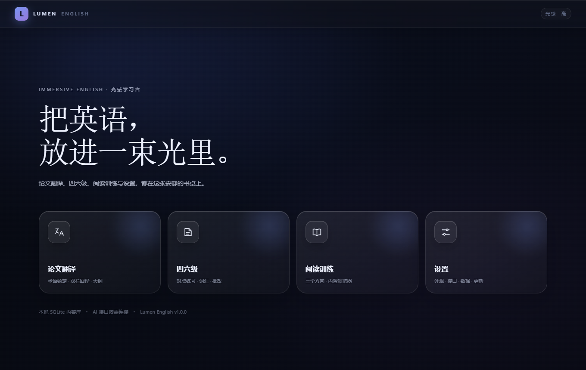
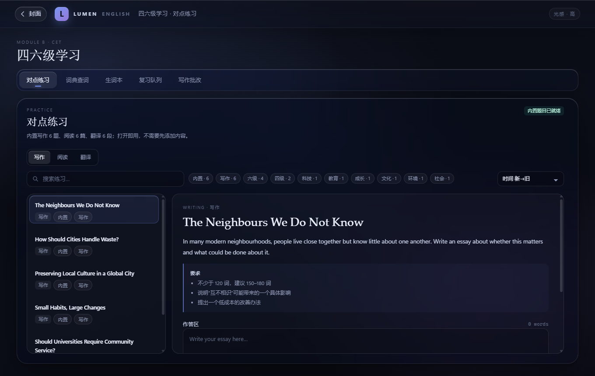
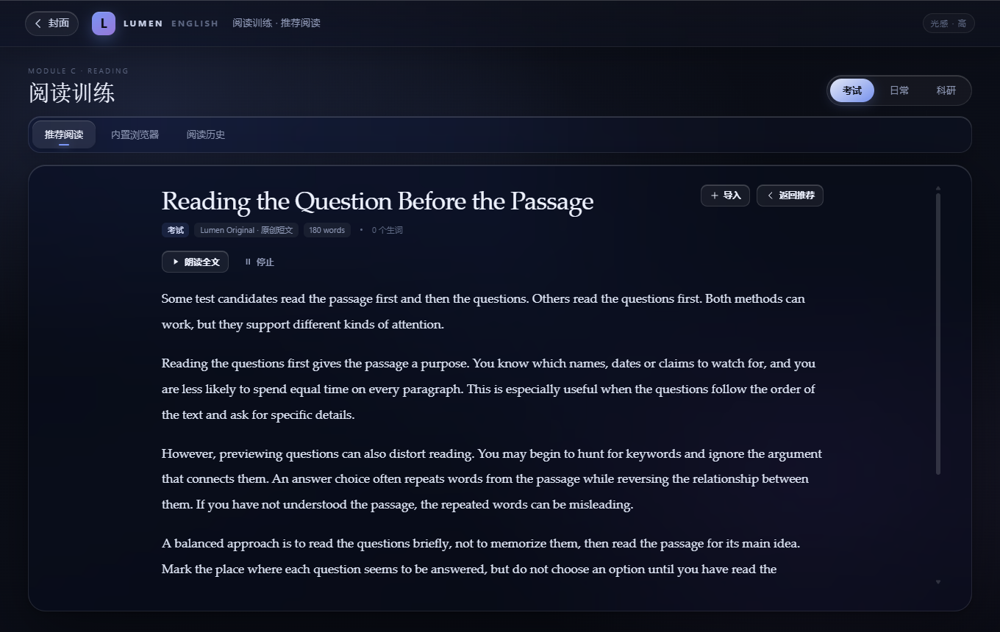
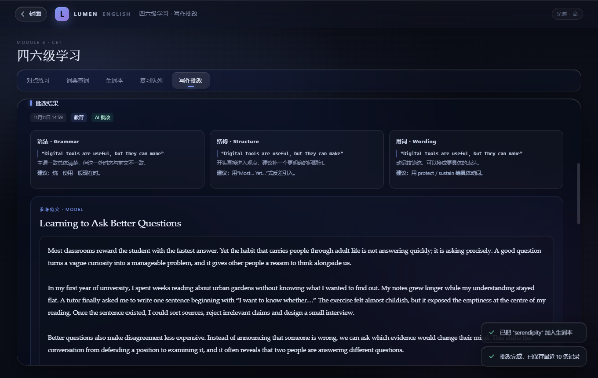
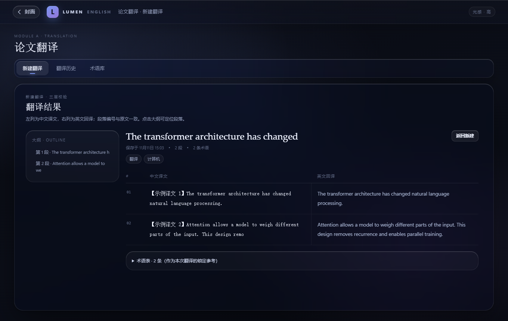

# Lumen English

A Windows desktop English-learning app built with Electron, native HTML/CSS/JavaScript,
SQLite (`better-sqlite3`) and an optional OpenAI-compatible AI endpoint. It ships with an
NSIS build, GitHub Releases publishing and silent `electron-updater` updates.

The interface is Chinese; the study material is English. No UI framework and no frontend
build step are used: the renderer loads static files directly.



| CET practice | Reading view |
| --- | --- |
|  |  |

| Writing feedback | Translation result |
| --- | --- |
|  |  |

## What is included

- **Shell & cover** — fixed four-icon cover (论文翻译 / 四六级 / 阅读训练 / 设置),
  in-window transitions, custom cover background (solid / gradient / local image) and
  custom window/taskbar icon.
- **Immersive light system** — Three.js/WebGL background blobs and instanced particles,
  CSS material layer, pointer spotlight, three manually selected tiers, and a master
  switch that destroys WebGL. `webview` containers are always opaque and never blurred.
- **Unified content layer** — one `contents` table, `content_tags`, and an external-content
  FTS5 index. All lists search with 300 ms debounce, filter by tag intersection, sort in
  SQL and remember their sort per list. Long lists use a virtual scroller.
- **Module A: paper translation** — `.txt` / `.md` / `.pdf` input (pdf.js in the renderer),
  terminology extraction at `temperature 0.1`, glossary-locked translation at `0.2`,
  paragraph-aligned Chinese/English back-translation, post-generated outline, history and
  a de-duplicated term library.
- **Module B: CET study** — six built-in writing prompts, six reading passages with
  questions and explanations, six translation paragraphs with reference translations and
  scoring points; dictionary lookup; wordbook; 1/2/4/7/15-day review queue; writing
  feedback with grammar/structure/wording quotes, model essay, paragraph commentary and
  at least three comparisons. The model essay section falls back to
  `essay-samples.json` when the endpoint is unavailable.
- **Module C: reading** — exam/daily/research directions, ten recommendations per
  direction (including ten original exam passages), in-app browser with Readability
  extraction, single and batch import, reading history, clickable words, Web Speech
  read-aloud, exam question-mode placeholder and research long-sentence highlighting.
- **Settings** — appearance, AI endpoint, data export/clear/restore, updater and reading
  source management.
- **Release pipeline** — `electron-builder.yml`, `src/main/updater.js`, preload update API,
  and `.github/workflows/build.yml` for tag/manual Windows builds.

## Run locally

Requirements:

- Windows 10/11 x64
- Node.js 20 or newer (CI uses Node 20; Node 22 LTS is a good local choice)
- npm

> `better-sqlite3` 13 declares `node >=22` as an npm engine hint and ships an
> N-API prebuild. On Node 20, `npm` may print an `EBADENGINE` warning; the prebuild
> still installs and loads. Node 22+ removes the warning.

```powershell
npm install
npm start
```

`npm install` performs two preparation steps:

1. copies the browser libraries (Three.js, PDF.js, Readability) from `node_modules` into
   `src/renderer/vendor` — the renderer has no bundler and no Node access;
2. nothing else. `better-sqlite3` 13 ships a Node-API prebuild in
   `node_modules/better-sqlite3/prebuilds/win32-x64.node`, which works with Electron 44
   without a local C++ toolchain.

If the Electron binary download is slow or blocked, set a mirror before installing:

```powershell
$env:ELECTRON_MIRROR = "https://npmmirror.com/mirrors/electron/"
npm install
```

If you run the app from an environment that also sets `ELECTRON_RUN_AS_NODE=1`
(some IDE/agent shells do), start it from a normal terminal or clear that variable first:

```powershell
Remove-Item Env:ELECTRON_RUN_AS_NODE -ErrorAction SilentlyContinue
npm start
```

### Minimal dependency list

Runtime (`dependencies`):

- `better-sqlite3` 13.0.3 — SQLite driver with an N-API prebuild
- `electron-store` 8.2.0 — settings and sort preferences only
- `electron-updater` 6.8.11 — silent updates via GitHub Releases

Build/development (`devDependencies`):

- `electron` 44.7.0
- `electron-builder` 26.18.0
- `@electron/rebuild` 3.7.2 — Node 20-compatible ABI check
- `three` 0.187.0 — copied into `src/renderer/vendor`
- `pdfjs-dist` 5.7.284 — copied into `src/renderer/vendor`
- `@mozilla/readability` 0.6.0 — copied into `src/renderer/vendor`

## AI endpoint

Open **设置 → AI 接口** and enter an OpenAI-compatible base URL. The default is:

```text
http://127.0.0.1:9655
```

Requests are sent to `{Base URL}/v1/chat/completions` with `stream: false`, a 30-second
timeout and one retry. The model is discovered from `{Base URL}/v1/models`; if that is not
available the client uses `gpt-4o-mini`, or `LUMEN_AI_MODEL` when set in the environment.
No credentials are captured and there is no web login flow.

When the endpoint is unavailable:

- translation returns a clear “接口未连接” error and does not write a half-finished record;
- writing review shows the built-in model essay and commentary, with an explicit notice that
  AI feedback is unavailable;
- practice, reading, dictionary, wordbook and settings continue to work.

Dictionary lookup uses `https://api.dictionaryapi.dev` directly from the main process. It is
not an AI call and is not routed through `ai-client.js`.

## Data locations

- SQLite database: `%APPDATA%\Lumen English\lumen-english.db`
- Settings/sort preferences: `%APPDATA%\Lumen English\lumen-settings.json`
- Imported cover/icon images: `%APPDATA%\Lumen English\media\`
- Updater log: `%APPDATA%\Lumen English\logs\updater.log`

All content, wordbook entries, review schedules and history records live in SQLite. Settings
and sort preferences use `electron-store`; content collections are never stored there.

## Tests used during development

The repository keeps two headless checks that do not need a visible desktop:

```powershell
# Repository/seed/FTS behavior under Electron's Node runtime
$env:ELECTRON_RUN_AS_NODE = "1"
.\node_modules\electron\dist\electron.exe scripts\test-db.js

# AI-unavailable fallback, model essay and comparison quotes
.\node_modules\electron\dist\electron.exe scripts\test-ai-fallback.js
```

A Chromium UI harness (static server + CDP interactions + screenshots) is described by
`scripts/serve-ui-test.js` and `scripts/cdp-ui-test.js`. It covers cover, CET practice,
dictionary, wordbook, writing feedback, reading, popover lookup, browser opacity, tier
switching, effects off, virtual scrolling and the batch modal. It is development-only and
is not packaged into the app.

## Build the installer

```powershell
npm run dist
```

`npm run dist:portable` builds a single self-extracting portable `.exe` for quick
verification. The release target remains NSIS.

Artifacts are written to `release/`:

- `Lumen-English-Setup-1.0.0.exe` — NSIS installer (`oneClick: false`, changeable install
  directory, per-user install)
- `latest.yml` — update manifest read by `electron-updater`
- blockmap and unpacked resources as generated by electron-builder

For a fast local build, `electron-builder.yml` sets `npmRebuild: false` and relies on the
Node-API prebuild. CI still runs `electron-rebuild` as an ABI sanity step.

If NSIS packaging appears to hang while electron-builder is running its temporary
`...Setup...exe` to generate the uninstaller, the build environment is blocking that helper
process (seen in some locked-down agent/VM sessions). In that case `scripts/local-installer.nsi`
can produce a standard per-user NSIS installer from `release/win-unpacked` with the same
layout and uninstaller:

```powershell
# Build the unpacked app first
npx electron-builder --win --dir

# Compile with the NSIS toolset cached by electron-builder
& "$env:LOCALAPPDATA\electron-builder\Cache\nsis-3.0.4.1\nsis-3.0.4.1-w8az6\Bin\makensis.exe" `
  scripts\local-installer.nsi
```

This fallback installer is unsigned and is intended for manual local distribution. Official
releases should use `npm run dist` / the GitHub Actions workflow so that electron-builder
produces the NSIS installer, blockmap and `latest.yml` for auto-update. Application data in
`%APPDATA%\Lumen English` is preserved on uninstall.

### ABI note

`better-sqlite3` 13 uses **Node-API (N-API)**, so its prebuilt `.node` binary is not tied to
a Chromium/V8 ABI. The included `prebuilds/win32-x64.node` is therefore valid in Electron
44. The classic ABI-matching route remains available:

```powershell
npm run rebuild
# equivalent to: electron-rebuild -f -w better-sqlite3
```

Run that only if you replace `better-sqlite3` with an older, non-N-API version, or if you
want a source-built binary. It requires Visual Studio Build Tools with the C++ workload.
`@electron/rebuild` is pinned to a Node 20-compatible release for CI.

## First GitHub release

1. **Create the repository and push the project.**

   ```powershell
   git init
   git add .
   git commit -m "feat: Lumen English 1.0.0"
   git branch -M main
   git remote add origin https://github.com/ROBIN012233/Robin.git
   git push -u origin main
   ```

2. **Point the updater at your repository.** Edit `electron-builder.yml`:

   ```yaml
   publish:
     provider: github
     owner: ROBIN012233
     repo: Robin
   ```

   These values are already set for this repository. If you publish from a fork or a
   renamed repository, update both fields and rebuild the installer, because they are
   compiled into `app-update.yml` and `latest.yml`.

3. **Allow Actions to write Releases.** In the repository:
   **Settings → Actions → General → Workflow permissions → Read and write permissions**.

4. **Trigger the workflow.** Either run **Actions → Build and release Windows app → Run
   workflow**, or create and push a tag:

   ```powershell
   npm version patch
   git push --follow-tags
   ```

5. **Verify the release.** The workflow runs on `windows-latest` with Node 20, runs
   `npm ci`, `npx electron-rebuild -f -w better-sqlite3`, and
   `npx electron-builder --win --publish always` with `GH_TOKEN` set to
   `${{ secrets.GITHUB_TOKEN }}`. The Release should contain the `.exe`, `latest.yml` and
   blockmap files.

6. **Verify the update path.** Install the previous version on a test machine, publish a
   newer tag, start the old app and wait 30 seconds. `electron-updater` checks in the
   background, silently downloads, and shows “新版本已就绪，退出时安装”. Close the app and
   the downloaded installer runs. It never calls `quitAndInstall()` while the user is
   working.

For a first release where you only want an artifact, run the manual workflow; it still uses
`--publish always`, so the repository must have a version and write permission. If you want a
local installer only, use `npm run dist`.

## Project tree

```text
lumen-english/
├─ package.json                     dependencies, scripts, electron entry
├─ electron-builder.yml             NSIS/appId/publish/asar configuration
├─ build/
│  ├─ icon.ico                      Windows installer/shortcut icon
│  └─ icon.png                      packaged window icon fallback
├─ src/
│  ├─ main/
│  │  ├─ main.js                    app lifecycle, window, security, webview policy
│  │  ├─ config.js                  electron-store settings, validation, media URL mapping
│  │  ├─ media.js                   cover/icon import dialogs and window icon updates
│  │  ├─ ipc.js                     all IPC handlers; renderer never touches Node
│  │  ├─ ai-client.js               OpenAI-compatible request layer (30s, one retry, JSON)
│  │  ├─ translation-service.js     terms → segment translation → back-translation → outline
│  │  ├─ writing-service.js         three-dimension feedback, model-essay fallback, compare
│  │  ├─ dictionary.js              external dictionary lookup + 20-item history
│  │  ├─ import-service.js          Readability extraction, single import, batch queue
│  │  ├─ updater.js                 electron-updater wiring and 30s/4h schedule
│  │  ├─ text.js                    paragraph splitting, 8000-char chunks, outline
│  │  ├─ db/
│  │  │  ├─ index.js                SQLite connection and first-run seed
│  │  │  ├─ schema.js               tables, tags, FTS5 and triggers
│  │  │  ├─ seed.js                 first-run/restore seed writer
│  │  │  ├─ contents.js             unified contents/tags/search/sort queries
│  │  │  ├─ words.js                wordbook and review scheduling
│  │  │  └─ records.js              translation/reading/writing/dictionary records
│  │  └─ seed/
│  │     ├─ reading.json            30 recommendations (10 each direction)
│  │     ├─ practice.json           18 practice items (6 each type)
│  │     └─ essay-samples.json      6 topics with paragraph-level commentary
│  ├─ preload/
│  │  ├─ preload.js                 contextBridge API (contents, AI, batch, updates, media)
│  │  └─ webview-preload.js         restricted guest channel (page info/selection only)
│  └─ renderer/
│     ├─ index.html                 shell, icon sprite, CSP
│     ├─ styles/                    base/light/material/module styles
│     ├─ vendor/                    copied Three.js, PDF.js, Readability (no bundler)
│     └─ js/
│        ├─ app.js                  boot, appearance application, global error UI
│        ├─ router.js               cover/module/subpage cache, direction and scroll state
│        ├─ light.js                Three.js scene, instancing, bloom, tier rebuild
│        ├─ api.js / state.js       bridge wrapper and renderer state
│        ├─ ui.js / utils.js        modal, toast, DOM helpers
│        ├─ filter-bar.js           search debounce + tag intersection + persisted sort
│        ├─ virtual-list.js         windowed DOM rows for large lists
│        ├─ pdf.js                  renderer-side PDF.js text extraction
│        ├─ components/             reader, translation result, writing result, import/batch
│        └─ views/                  translation, CET, reading, settings
├─ scripts/
│  ├─ prepare-vendor.js             copy static libraries after npm install
│  ├─ test-db.js                    seed/FTS/tag/word/review/history checks
│  ├─ test-ai-fallback.js           offline AI fallback and comparison checks
│  ├─ serve-ui-test.js              dev static server for headless UI checks
│  ├─ cdp-ui-test.js                CDP interaction/screenshot test
│  ├─ cdp-pdf-test.js               PDF extraction UI test
│  └─ local-installer.nsi           fallback per-user NSIS installer for blocked environments
├─ ui-test/
│  ├─ index.html                    test copy of the shell with the mock bridge
│  ├─ mock-api.js                   UI-test-only window.api mock
│  └─ sample.pdf                    PDF extraction test fixture
├─ docs/                            README screenshots
└─ .github/workflows/build.yml      tag/manual Windows release workflow
```

## Design notes

- The renderer is loaded from local files with a restrictive CSP. It has no `require`, no
  Node globals and only the frozen `window.api` bridge.
- The `<webview>` guest is locked down in `will-attach-webview` and gets a dedicated
  preload that can send only page-info/selection messages. There is no generic IPC bridge
  inside the guest.
- Backdrop-filter is limited to the top bar, secondary nav and module surface (three visible
  elements). Lists and cards use static translucent surfaces. No backdrop-filter exists on
  or around a webview; `body[data-has-webview]` switches those surfaces to opaque.
- Tier switching tears down the WebGL scene, renderer and canvas, then rebuilds a fresh
  canvas. The “关闭沉浸光感” switch removes the canvas entirely.
- Writing feedback always renders the model-essay section. When the endpoint fails it still
  uses the built-in JSON sample and a deterministic comparison that quotes both texts.
